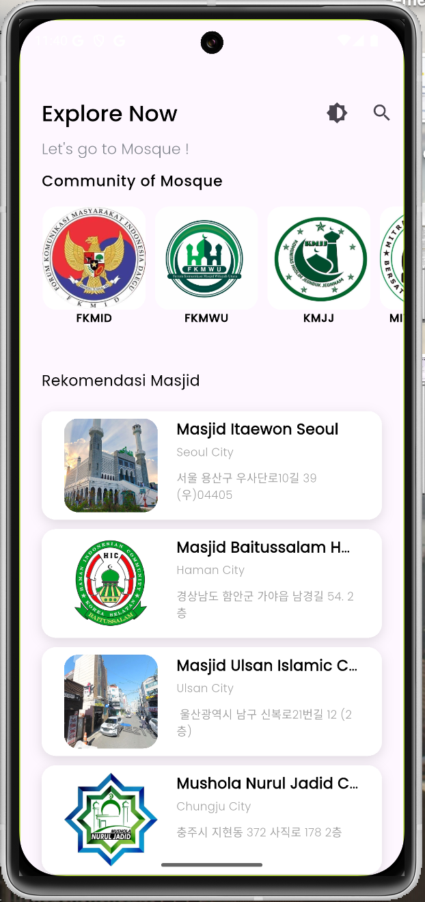
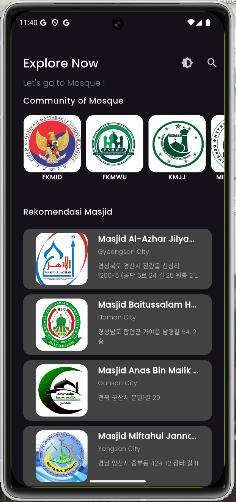
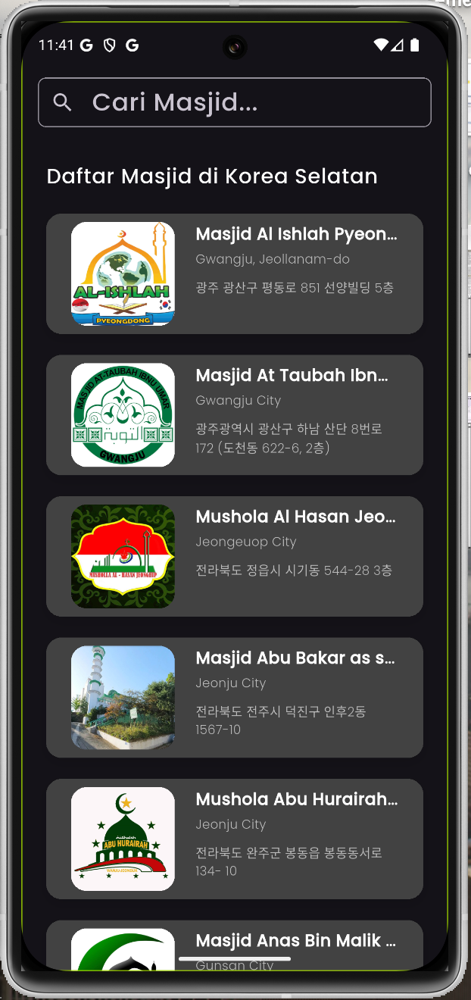
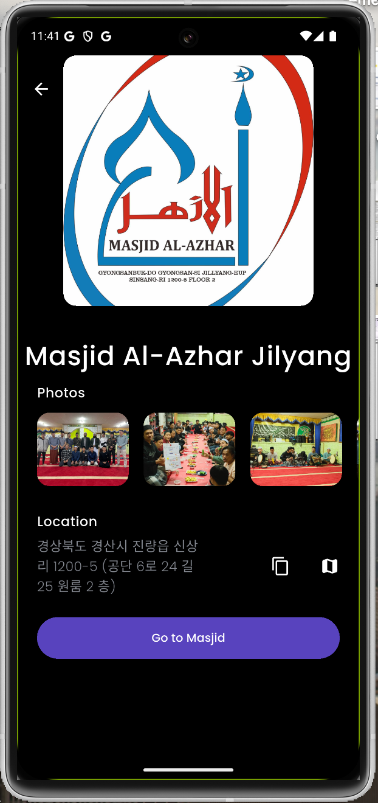
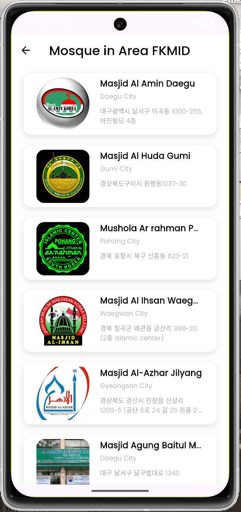
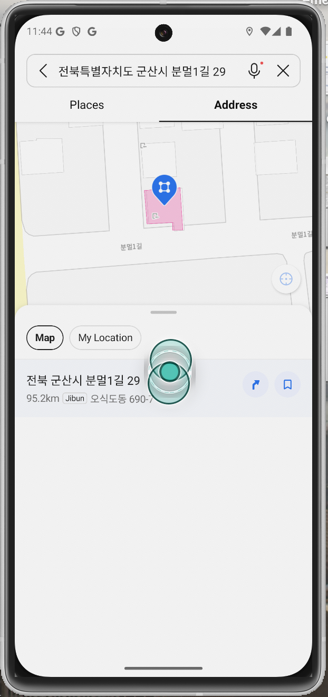
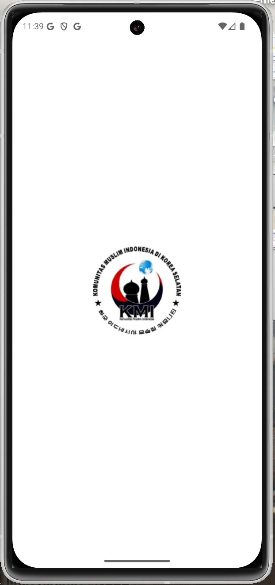

<p align="center">
  
</p>

<h1 align="center">Masjid Korea</h1>

<p align="center">
  <b>Pencari masjid terdekat di Korea Selatan.</b><br>
  Nama, alamat, foto kegiatan, dan navigasi langsung ke lokasi.
</p>

<p align="center">
  <a href="https://flutter.dev"></a>
  
  <a href="https://firebase.google.com"></a>
  
</p>

---

## ✨ Preview

<p align="center">
  
</p>

<table align="center">
  <tr>
    <td></td>
    <td></td>
    <td></td>
    <td></td>
  </tr>
  <tr>
    <td align="center">Home</td>
    <td align="center">Dark mode</td>
    <td align="center">Pencarian</td>
    <td align="center">Detail</td>
  </tr>
</table>

<table align="center">
  <tr>
    <td></td>
    <td></td>
    <td></td>
  </tr>
  <tr>
    <td align="center">Komunitas</td>
    <td align="center">Navigasi KakaoMap</td>
    <td align="center">Splash</td>
  </tr>
</table>

---

## 📖 Tentang

Masjid Korea membantu muslim — terutama WNI dan pelajar — menemukan masjid di seluruh Korea
Selatan. Dibangun dengan Flutter, **BLoC (Cubit)**, dan pendekatan **Clean Architecture**
supaya mudah dirawat dan dikembangkan.

---

## 🌟 Fitur

- 🕌 Daftar masjid lengkap dengan nama, alamat, dan foto kegiatan
- 📏 **Jarak Haversine** dari lokasi pengguna ke masjid
- 🗺️ Navigasi ke masjid lewat **KakaoMap**
- ☁️ Data real-time di **Firebase Cloud Firestore**
- 🎭 Animasi Lottie untuk loading
- 🌗 Mode terang & gelap
- 📋 Salin alamat ke clipboard
- 🔎 Halaman pencarian masjid

---

## 🛠️ Tech Stack

| Area | Pilihan |
|---|---|
| Framework | Flutter (Android + Web) |
| State management | BLoC / Cubit |
| Backend | Firebase Cloud Firestore |
| Lokasi | `geolocator`, `location` |
| HTTP | Dio |
| Peta & navigasi | KakaoMap via `url_launcher` |
| Animasi | Lottie |

---

## 🚀 Menjalankan

```bash
flutter pub get
flutter run
```

Tambahkan konfigurasi Firebase (`firebase_options.dart`) dan API key KakaoMap sebelum build.

---

## 📄 Lisensi

MIT © Fatchurizkia Ruly Octareza
